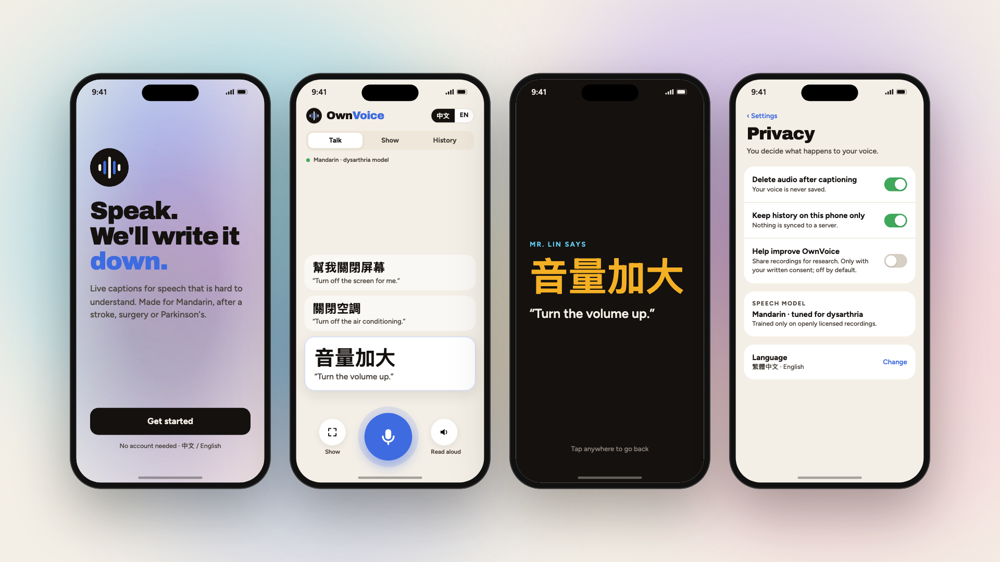

# OwnVoice phone app (in development)

The OwnVoice app puts live captions in your pocket. The Chrome extension covers calls on a
computer; the app covers everywhere else: at work, at a service counter, at the doctor.

Status (2026-10-21): **designed, not yet built.** The screens below are the agreed design. Work on
the iOS and Android build starts right after the 2026 Presidential Hackathon finals. Until it
ships, the website and the Chrome extension are the working ways to use OwnVoice.



## Screens

| Screen | What it does |
|---|---|
| `1-welcome.png` | First launch. No account; Chinese or English. |
| `2-talk.png` | Live captions. The newest sentence is large, in Traditional Chinese, with an English line under it. Buttons: **Show**, the microphone, **Read aloud** (speaks the text in a system voice, never presented as the user's own voice). |
| `3-show.png` | One tap turns the last sentence into big text to hold up to a coworker, pharmacist or clerk. |
| `4-privacy.png` | Privacy controls. Audio is deleted after captioning (on); history stays on the phone (on); sharing recordings for research is **off by default** and needs written consent. |

The captions in the screens are OwnVoice's real output on recordings of a real speaker with
dysarthria (MDSC / AISHELL-6B, speaker DM0005), not invented text.

## Where the design lives

The screens are React components in `video/remotion/src/app.tsx` (`WelcomeScreen`, `TalkScreen`,
`ShowScreen`, `PrivacyScreen`, `Phone`). They use the product site's palette and type
(`video/remotion/src/theme.ts`). The same components animate the app scene in the demo video and
render these stills:

```bash
cd video/remotion
B=$(ls -d ~/Library/Caches/ms-playwright/chromium_headless_shell-1208/*/chrome-headless-shell)
npx remotion still src/index.ts AppStills ../../app/screens/all-screens.png --browser-executable=$B
npx remotion still src/index.ts AppScreen ../../app/screens/2-talk.png --props='{"which":1}' --image-format=png --browser-executable=$B
```

## Build plan

1. A React Native (Expo) client that reuses these components' layout and the extension's
   segmenting logic (`extension/sidepanel.js`: cut at pauses, 0.6–7 s segments).
2. Recognition through the same `/transcribe_chunk` API the extension uses, against a hosted
   model server first.
3. Then on-device recognition, so audio never leaves the phone. This needs the model converted
   and measured on a phone; we have not measured phone speed yet and make no claim about it.
